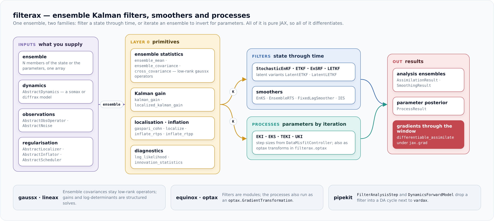

<div align="center">

<picture>
  <source media="(prefers-color-scheme: dark)" srcset="docs/assets/logo-dark.svg">
  
</picture>

**Ensemble Kalman filters, smoothers and inversion in JAX: one ensemble update, differentiable end to end.**

[](https://github.com/jejjohnson/filterax/actions/workflows/ci.yml)
[](https://github.com/jejjohnson/filterax/actions/workflows/lint.yml)
[](https://github.com/jejjohnson/filterax/actions/workflows/typecheck.yml)
[](https://jejjohnson.github.io/filterax/)
[](https://codecov.io/gh/jejjohnson/filterax)
[](https://www.python.org/)
[](LICENSE)
[](https://github.com/astral-sh/ruff)
[](https://github.com/astral-sh/uv)

📖 [Documentation](https://jejjohnson.github.io/filterax/) ·
📐 [Maths reference](https://jejjohnson.github.io/filterax/math/problem-setting/) ·
🧮 [API reference](https://jejjohnson.github.io/filterax/reference/) ·
🧭 [Design docs](https://jejjohnson.github.io/filterax/design-docs/readme/)

</div>

---

Filtering a state through time and inverting for parameters are the same ensemble update applied to different unknowns.
`filterax` implements both families on one set of seams (ensemble, observation operator, noise operator, dynamics) as [`equinox`](https://github.com/patrick-kidger/equinox) modules, so switching filter, smoother or inversion method is a constructor change.

Everything is pure JAX, so every analysis differentiates: there is no separate differentiable mode, and a training loop can backpropagate through a whole assimilation window.
The linear algebra is delegated to [`gaussx`](https://github.com/jejjohnson/gaussx): ensemble covariances stay low-rank [`lineax`](https://github.com/patrick-kidger/lineax) operators, the analyses work in the $N_\mathcal{E}$-dimensional ensemble space, and their derivatives stay finite at the repeated eigenvalues every ensemble analysis has.

<p align="center"></p>

## 🌟 Highlights

- 🛰️ **Seven sequential filters**, from the stochastic EnKF to the local ETKF, all as one-call analysis steps and as full assimilation loops.
- ⏪ **Five ensemble smoothers**, from the ensemble RTS smoother to the iterative ensemble smoother, plus an exact Kalman smoother as the reference.
- 🎯 **Seven inversion processes**: EKI and its Tikhonov, transform, Gauss-Newton and sparse variants, the ensemble Kalman sampler and unscented Kalman inversion.
- 🧷 **Differentiable by construction**: full-tape, checkpointed and truncated adjoints, and ROAD-EnKF local gradients.
- 🧱 **Operator covariances**: the ensemble covariance is a `gaussx.LowRankUpdate`, and structured noise (diagonal, block-diagonal, Kronecker) is never densified.
- 🧮 **Float32-aware numerics**: rank-$D_y$ analyses, singular-value pseudo-inverses and eigenvalue floors, each measured against float64 in the maths reference.
- 🔌 **Plugs into the stack**: processes run as `optax.GradientTransformation`s, and filters run inside `pipekit` assimilation cycles.

## 📐 The methods

All filters share one update, the ensemble estimate of the Kalman analysis

```math
\bar{\mathbf{x}}_{t \mid t} = \bar{\mathbf{x}}_{t \mid t-1} + \hat{\boldsymbol{\Sigma}}_{xy} \hat{\boldsymbol{\Sigma}}_y^{-1} (\mathbf{y}_t - \bar{\mathbf{h}}),
```

where the sample covariances come from the ensemble rather than a stored $D_x \times D_x$ matrix.
What differs is how the members are updated: with perturbed observations, by a deterministic transform in ensemble space, one observation at a time, or locally around each grid point.
The [ETKF chapter](https://jejjohnson.github.io/filterax/math/etkf/) derives the transform form, and the [Kalman update chapter](https://jejjohnson.github.io/filterax/math/kalman-update/) the gain.

| Filter | Update | Reach for it when |
| --- | --- | --- |
| `StochasticEnKF` | Perturbed observations | You want the textbook EnKF, or a baseline |
| `ETKF` | Symmetric transform in ensemble space | A deterministic, differentiable analysis; the right default |
| `ETKF_Livings` | ETKF with a mean-preserving random rotation | Long runs where the symmetric transform leaves outlying members |
| `EnSRF` | Square-root update, batch form | The square-root filter as Whitaker and Hamill write it |
| `EnSRF_Serial` | One observation at a time | Many uncorrelated observations, or float32 with widely mixed noise |
| `ESTKF` | Transform in the error subspace | The error-subspace form of the ETKF |
| `LETKF` | One ETKF per grid point, with tapered observation weights | A state much larger than the ensemble |
| `LatentETKF`, `LatentLETKF` | The analysis in a learned latent space | A field whose dynamics live on a low-dimensional manifold |
| `SquareRootKF` | Exact Kalman filter, square-root parallel form | Linear-Gaussian models, and as the reference |

| Smoother | Method |
| --- | --- |
| `EnKS` | Ensemble Kalman smoother, a backward pass over stored filter histories |
| `EnsembleRTS` | Ensemble Rauch-Tung-Striebel smoother |
| `FixedLagSmoother` | Bounded-memory smoothing over a fixed lag |
| `EnsembleSqrtSmoother` | Deterministic square-root smoother |
| `IES` | Iterative ensemble smoother, Gauss-Newton in ensemble space |
| `KalmanSmoother` | Exact Kalman filter and RTS smoother over irregular times |

| Process | Method |
| --- | --- |
| `EKI` | Ensemble Kalman inversion |
| `TEKI` | Tikhonov-regularised EKI |
| `ETKI` | Ensemble transform Kalman inversion |
| `GNKI` | Gauss-Newton Kalman inversion |
| `SparseInversion` | Sparse ensemble Kalman inversion |
| `EKS` | Ensemble Kalman sampler |
| `UKI` | Unscented Kalman inversion |

Filters exist in two layers: `filterax.filters.ETKF().analysis(...)` is one analysis step, and `filterax.ETKF(dynamics=..., obs_op=...).assimilate(...)` is the forecast-analysis loop around it.
The processes take step sizes from `FixedScheduler`, `DataMisfitController` or `EKSStableScheduler`.

## 📥 Install

`filterax` is not on PyPI yet.
Install it from GitHub with [uv](https://docs.astral.sh/uv/) or pip, which also fetch `gaussx` at the release `pyproject.toml` pins:

```bash
uv add "filterax @ git+https://github.com/jejjohnson/filterax"
```

```bash
pip install "filterax @ git+https://github.com/jejjohnson/filterax"
```

Requires Python 3.12 or later.
Runtime dependencies are `jax`, `jaxlib`, `jaxtyping`, `equinox`, `lineax`, `optax`, `einops`, `einx` and `gaussx`.

## 🌪️ Quickstart: the local ETKF on Lorenz-96

A twin experiment: a truth on the Lorenz-96 attractor with $D_x = 40$ sites, noisy observations of every second site with unit variance, and a 20-member ensemble that starts far from the truth.

```python
import einx
import filterax as flx
import jax
import jax.numpy as jnp
import jax.random as jr
import lineax as lx
from jaxtyping import Array, Float

jax.config.update("jax_enable_x64", True)

Op = lx.AbstractLinearOperator
State = Float[Array, " site"]

# Shapes: T = 100 windows; D_x = 40 sites; D_y = 20 observed sites; N_E = 20


# user
# dxₖ/dt = (xₖ₊₁ − xₖ₋₂) xₖ₋₁ − xₖ + 8, one RK4 step of Δt = 0.05
def lorenz96(state: State, t0: float = 0.0, t1: float = 0.0) -> State:
    def tendency(x: State) -> State:
        return (jnp.roll(x, -1) - jnp.roll(x, 2)) * jnp.roll(x, 1) - x + 8.0

    k1 = tendency(state)
    k2 = tendency(state + 0.025 * k1)
    k3 = tendency(state + 0.025 * k2)
    k4 = tendency(state + 0.05 * k3)
    return state + 0.05 / 6.0 * (k1 + 2.0 * k2 + 2.0 * k3 + k4)


# user
# xₜ₊₁ = f(xₜ), stacked over the run
def advance(state: State, _: None) -> tuple[State, State]:
    next_state = lorenz96(state)
    return next_state, next_state


start: State = jax.lax.fori_loop(  # → (D_x,)
    0, 1000, lambda _, x: lorenz96(x), 8.0 + jr.normal(jr.key(0), (40,))
)
truth: Float[Array, "time site"] = jax.lax.scan(advance, start, length=100)[1]
sites: Float[Array, " obs"] = jnp.arange(0, 40, 2)  # → (D_y,)
# yₜ = H xₜ + εₜ, εₜ ~ 𝒩(0, I)
observed = truth[:, sites] + jr.normal(jr.key(1), (100, 20))  # → (T, D_y)
windows = [(observed[t], 0.05 * (t + 1)) for t in range(100)]
noise: Op = lx.DiagonalLinearOperator(jnp.ones(20))  # (D_y, D_y)
members = start + 2.0 * jr.normal(jr.key(2), (20, 40))  # → (N_E, D_x)

# today (filterax)
# one ETKF per site, with the observations within 8 sites weighted by Gaspari-Cohn
letkf = flx.LETKF(dynamics=lorenz96, obs_op=lambda x: x[sites], radius=8.0)
# today (filterax)
result = letkf.assimilate(
    members,
    windows,
    noise,
    state_coords=jnp.arange(40.0)[:, None],
    obs_coords=sites[:, None] * 1.0,
)
# x̄_t|t over the second half of the run
settled = einx.mean("time [member] site", result.analysis_history[50:])
rmse = jnp.sqrt(jnp.mean((settled - truth[50:]) ** 2))  # → ()
print(f"LETKF RMSE {rmse:.2f}, against unit observation noise")
```

This prints `LETKF RMSE 0.33, against unit observation noise`, so the filter beats the observations at the observed sites and fills in the unobserved half.

## ♻️ Swap the method, keep the loop

The global ETKF takes the same constructor without the localization, so the comparison is two lines, with the same inflation:

```python
# today (filterax)
etkf = flx.ETKF(
    dynamics=lorenz96, obs_op=lambda x: x[sites], inflator=flx.RTPS(alpha=0.5)
)
history = etkf.assimilate(members, windows, noise).analysis_history
settled = einx.mean("time [member] site", history[50:])  # → (T / 2, D_x)
print(f"ETKF RMSE {jnp.sqrt(jnp.mean((settled - truth[50:]) ** 2)):.2f}")
```

This prints `ETKF RMSE 0.41`.
One twin is not a verdict, so [chapter 19](https://jejjohnson.github.io/filterax/math/lorenz96-example/) repeats this over eight: the LETKF stays healthy on all eight with no inflation, while the global ETKF needs RTPS at 0.5 to survive all eight, and without inflation only two of eight stay healthy.
The same stored histories feed any smoother, as `flx.EnKS().smooth(result.forecast_history, result.analysis_history)`, and any filter becomes a pipekit analysis step through `flx.pipekit.FilterAnalysisStep`.

## 🔬 What else is in the box

| Area | Symbols | Notes |
| --- | --- | --- |
| Ensemble statistics | `ensemble_mean`, `ensemble_anomalies`, `ensemble_covariance`, `cross_covariance` | The covariance is a `gaussx.LowRankUpdate`, never a dense matrix you did not ask for |
| Gain and likelihood | `kalman_gain`, `localized_kalman_gain`, `innovation_covariance`, `innovation_statistics`, `log_likelihood`, `perturbed_observations` | Structured observation noise keeps its own solve |
| Localization | `gaspari_cohn`, `gaussian_taper`, `soar_taper`, `hard_cutoff`, `localization_matrix`, `localize`, `adaptive_localization`, `euclidean_distance`, `haversine_distance` | Tapers take a half-width; Gaspari-Cohn vanishes at twice it |
| Inflation | `MultiplicativeInflator`, `AdditiveInflator`, `RTPS`, `RTPP`, `inflate_multiplicative`, `inflate_additive`, `inflate_rtps`, `inflate_rtpp`, `inflate_adaptive`, `ledoit_wolf_shrinkage` | Class form for the loops, function form for one step |
| Diagnostics | `filterax.utils`: `chi2_consistency`, `desroziers_R_estimate`, `dfs_from_gain`, `rank_histogram`, `crps_ensemble`, `spread_skill_ratio`, `rmse_vs_truth` and twelve more | Consistency, information content and skill |
| Differentiable training | `differentiable_assimilate`, `filterax.differentiable`: `DirectAdjoint`, `RecursiveCheckpointAdjoint`, `TruncatedAdjoint`, `road_enkf_loss_and_grad`, `road_enkf_grad_step` | Learn dynamics, observation operators or inflation through the filter |
| optax | `filterax.optax.eki`, `eks`, `uki` | Inversion as an `optax.GradientTransformation` |
| Latent DA | `LatentETKF`, `LatentLETKF`, `LatentDynamics`, `EncodedDynamics`, `LiftedObs`, `IdentityLatentMap`, `latent_ensemble`, `decode_ensemble` | Assimilate in a learned latent space and decode back |
| pipekit | `filterax.pipekit`: `FilterAnalysisStep`, `DynamicsForwardModel`, `LinearizableObsOperator` | Filters as steps of a `pipekit_cycle` assimilation cycle |

## 📖 Documentation

- **[Maths reference](https://jejjohnson.github.io/filterax/math/problem-setting/)**: 20 chapters.
  - Foundation (1–3) and the analysis methods (4–10): the Kalman update, each filter, the inversion processes and the smoothers.
  - Cross-cutting concerns (11–16): localization, inflation, diagnostics, differentiable assimilation, latent DA and the assimilation cycle.
  - The exact references and numerics (17–18), then two worked examples (19–20), Lorenz-96 filtering and a nonlinear inversion.
  - Every chapter's code runs in the test suite, and the printed numbers in the text came from it.
- **[API reference](https://jejjohnson.github.io/filterax/reference/)**: every public symbol, generated from the docstrings.
- **[Design docs](https://jejjohnson.github.io/filterax/design-docs/readme/)**: vision, architecture, ownership boundaries and the decision log.

## 🧩 Ecosystem

`filterax` owns the ensemble methods and nothing else:

| Concern | Owner |
| --- | --- |
| Structured operators, solves, log-determinants and the ensemble-space analyses | [`gaussx`](https://github.com/jejjohnson/gaussx) |
| Linear operators and solvers | [`lineax`](https://github.com/patrick-kidger/lineax) |
| Modules and pytrees | [`equinox`](https://github.com/patrick-kidger/equinox) |
| Optimisers | [`optax`](https://github.com/google-deepmind/optax) |
| Geophysical forward models | [`somax`](https://github.com/jejjohnson/somax), as `AbstractDynamics` |
| ODE integration and adjoints | [`diffrax`](https://github.com/patrick-kidger/diffrax), inside user dynamics |
| Variational DA (3DVar, 4DVar, 4DVarNet) | [`vardax`](https://github.com/jejjohnson/vardax) |
| DA cycle protocols | [`pipekit`](https://github.com/jejjohnson/pipekit) and `pipekit-cycle` |

See [boundaries](docs/design_docs/boundaries.md) for the full ownership map.

## 🌳 Repository layout

```
src/filterax/
├── __init__.py          ← the public API
├── filters/             ← Layer 1 analysis steps (filterax.filters)
├── smoothers/           ← smoothers (filterax.smoothers)
├── processes/           ← inversion processes (filterax.processes)
├── differentiable/      ← adjoints and ROAD-EnKF (filterax.differentiable)
├── optax/               ← processes as optax transforms (filterax.optax)
├── utils/               ← diagnostics (filterax.utils)
├── pipekit/             ← pipekit-cycle adapters (filterax.pipekit)
├── _primitives/         ← statistics, gain, likelihood, localization, inflation
├── _filters/            ← sequential, parametric and latent filters, Layer 2 loops
├── _processes/          ← processes, schedulers, optax transforms
├── _smoothers.py        ← the smoothers
└── _train/              ← differentiable assimilation and adjoints
docs/                    ← maths reference (MyST), API pages (MkDocs), design docs
tests/                   ← fast, slow and integration tiers
```

## ⚙️ Development

```bash
make install       # uv sync --all-groups + pre-commit hooks
make test-fast     # the fast tier, as PR CI runs it
make test-slow     # the slow and integration tiers
make lint          # ruff check .
make typecheck     # ty check src/filterax
make docs          # MyST prose + MkDocs API, into public/
```

PR CI runs the fast tier on Python 3.12 and 3.13 and validates the docs.
The slow and integration tiers run weekly, and on any PR labelled `run-slow`, which a change to a filter's, smoother's or process's numerics should carry.
Commits are conventional, and release-please cuts the versions.

## 🎓 References

- Evensen (1994). [Sequential data assimilation with a nonlinear quasi-geostrophic model using Monte Carlo methods to forecast error statistics](https://doi.org/10.1029/94JC00572). *JGR Oceans*.
- Bishop, Etherton & Majumdar (2001). [Adaptive sampling with the ensemble transform Kalman filter. Part I](https://doi.org/10.1175/1520-0493(2001)129<0420:ASWTET>2.0.CO;2). *Monthly Weather Review*.
- Hunt, Kostelich & Szunyogh (2007). [Efficient data assimilation for spatiotemporal chaos: a local ensemble transform Kalman filter](https://doi.org/10.1016/j.physd.2006.11.008). *Physica D*.
- Iglesias, Law & Stuart (2013). [Ensemble Kalman methods for inverse problems](https://doi.org/10.1088/0266-5611/29/4/045001). *Inverse Problems*.
- Carrassi et al. (2018). [Data assimilation in the geosciences: an overview of methods, issues, and perspectives](https://doi.org/10.1002/wcc.535). *WIREs Climate Change*.
- Each chapter of the maths reference lists its own sources.

## 📄 License

MIT. See [LICENSE](LICENSE).
